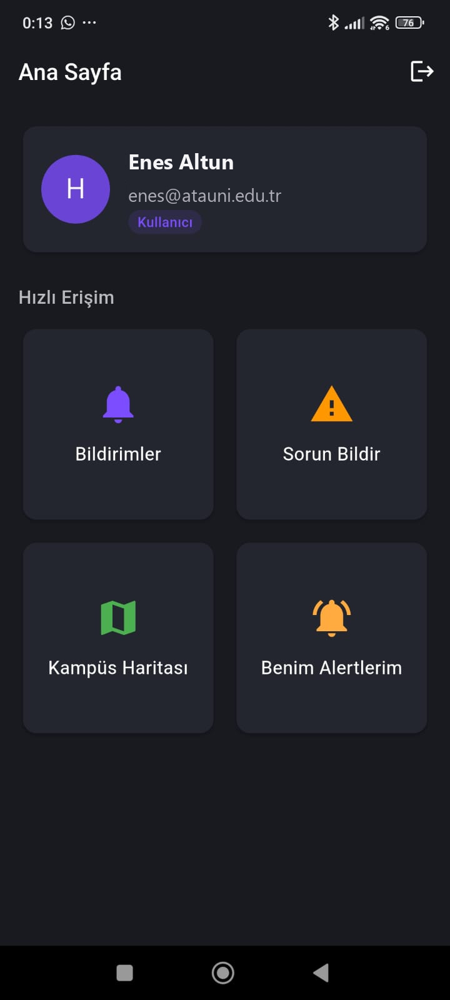
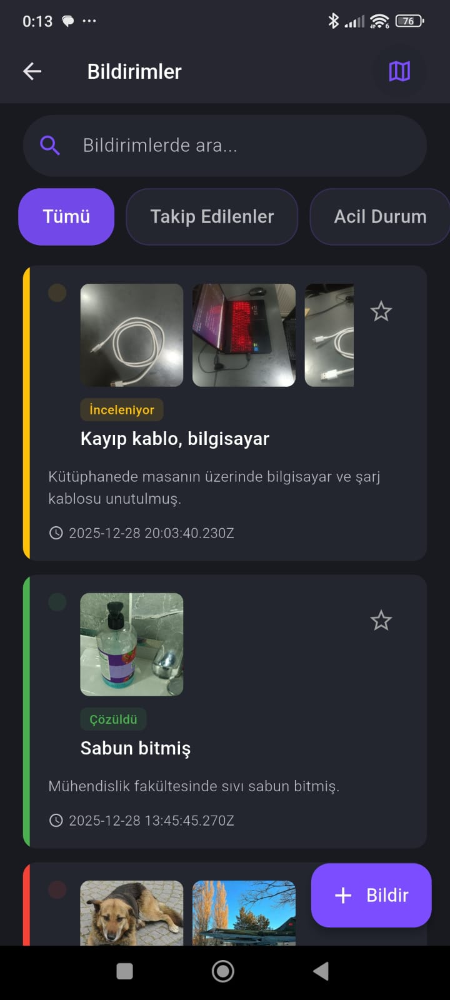
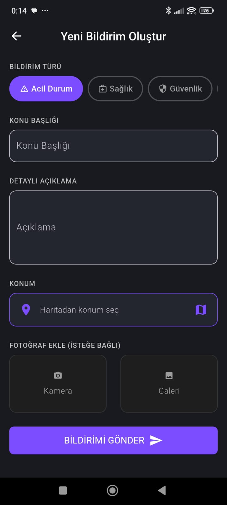
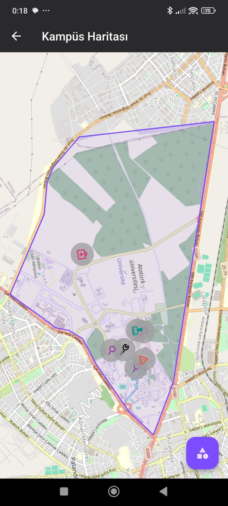
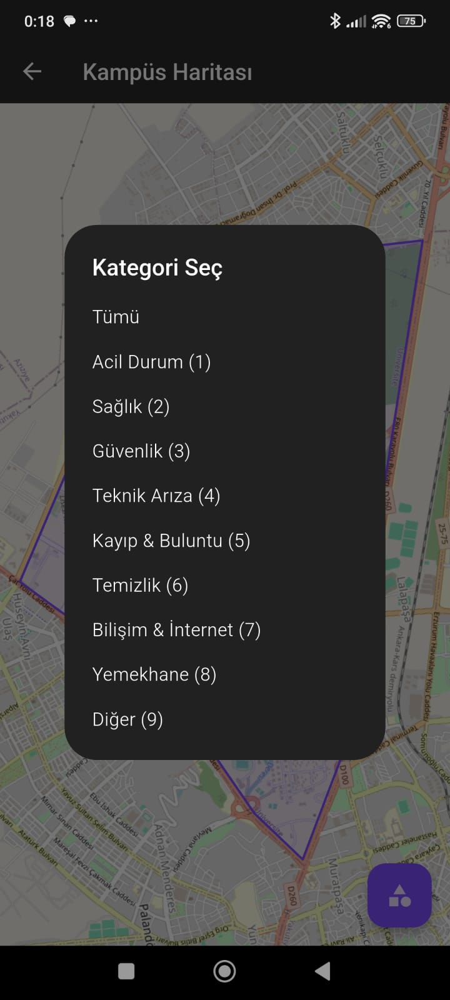
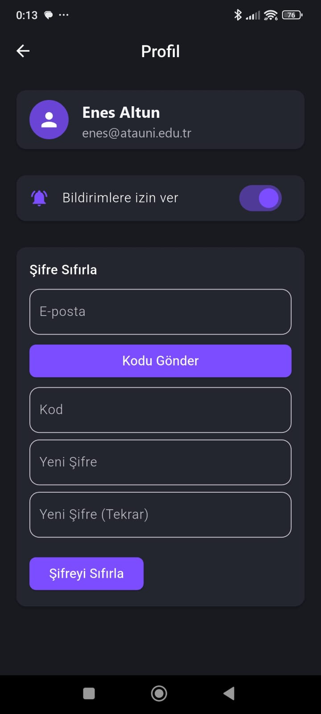
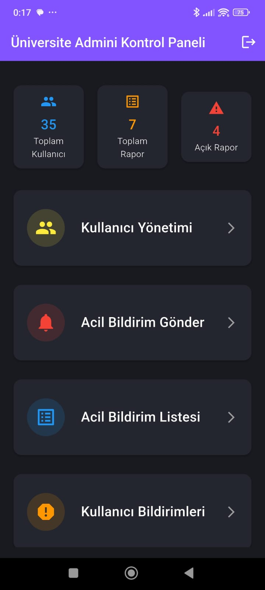
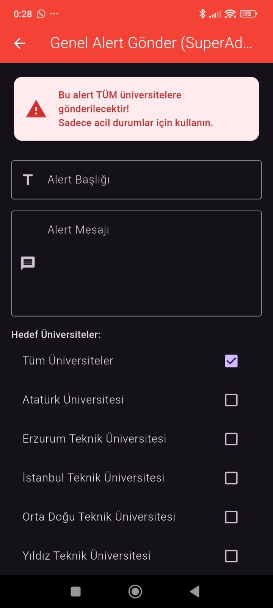

# Akıllı Kampüs Mobil Uygulaması / Safe Campus Mobile App

Üniversite kampüsleri için güvenlik ve olay bildirim mobil uygulaması.
A campus safety and incident reporting mobile application for universities.

[Türkçe](#türkçe) | [English](#english)

---

## Türkçe

### Genel Bakış

Akıllı Kampüs, kampüs kullanıcılarının güvenlik olaylarını bildirebildiği,
yöneticilerin bu bildirimleri yönetip duyuru/uyarı gönderebildiği bir Flutter
mobil uygulamasıdır. Uygulama bir REST API arka ucu ile haberleşir ve anlık
bildirimler için Firebase kullanır.

### Özellikler

- Kimlik doğrulama: kayıt, giriş, şifremi unuttum ve şifre sıfırlama
- Rol tabanlı erişim: standart kullanıcı, üniversite yöneticisi (uni admin),
  süper yönetici (super admin)
- Olay/güvenlik bildirimleri: görsel ekleme, bildirim takibi
- Uyarı yönetimi: genel ve üniversite bazlı uyarı gönderme ve listeleme
- Anlık bildirimler: Firebase Cloud Messaging ve cihaz içi yerel bildirimler
- Harita: kampüs sınırlarının (polygon) gösterimi ve harita üzerinden konum seçimi
- Profil yönetimi
- Yönetici panelleri: kullanıcı yönetimi, rapor yönetimi, gösterge paneli (dashboard)

### Ekran Görüntüleri

<p align="center">
  
  
  
  
</p>
<p align="center">
  
  
  
  
</p>

### Teknoloji

- Flutter (Dart SDK ^3.8.1)
- Durum yönetimi: Riverpod (flutter_riverpod)
- Ağ: http
- Harita: flutter_map, latlong2, google_maps_flutter
- Bildirim: firebase_messaging, flutter_local_notifications, permission_handler
- Firebase: firebase_core, firebase_storage, cloud_firestore
- Görsel: image_picker
- Yapılandırma: flutter_dotenv (.env)

### Proje Yapısı

```
Akilli_Kampus_Mobil_Uygulamasi/
  safe_campus_app/        Flutter mobil uygulaması
    lib/
      core/               Sabitler, rotalar, yardımcılar, provider'lar
      logic/models/       Veri modelleri (User, Report, Alert, University ...)
      presentation/       Ekranlar ve widget'lar (rol bazlı ekranlar dahil)
      services/           API servisleri (auth, report, alert, admin, harita ...)
    .env.example          Ortam değişkenleri şablonu
  backend_api/            Arka uç için yer tutucu (REST API ayrı tutulur)
  database/               Veritabanı yedekleri (sürüm kontrolüne dahil değildir)
```

Not: Arka uç (backend) `HOST:3000/api` adresinde çalışan ayrı bir REST
servisidir ve bu depoya dahil değildir.

### Kurulum

Ön koşullar: Flutter SDK, çalışan bir backend API ve bir Firebase projesi.

1. Bağımlılıkları yükleyin:
   ```
   cd safe_campus_app
   flutter pub get
   ```

2. Ortam değişkenlerini ayarlayın (`.env` sürüm kontrolüne dahil değildir):
   ```
   cp .env.example .env
   ```
   `.env` içinde backend adresini düzenleyin:
   ```
   API_HOST=192.168.1.14
   API_PORT=3000
   ```

3. Firebase yapılandırması:
   `android/app/google-services.json.example` dosyasını
   `android/app/google-services.json` olarak kopyalayın ve kendi Firebase
   proje bilgilerinizi girin. Bu dosya gizlidir ve sürüm kontrolüne dahil edilmez.

4. Uygulamayı çalıştırın:
   ```
   flutter run
   ```

### Güvenlik Notu

`.env`, `google-services.json` ve veritabanı yedek (`.bak`) dosyaları kişisel
veri ve gizli anahtar içerebilir; bunlar `.gitignore` ile dışarıda tutulur ve
asla depoya eklenmemelidir.

---

## English

### Overview

Safe Campus is a Flutter mobile application that lets campus users report
safety incidents, and lets administrators manage those reports and send
alerts. The app communicates with a REST API backend and uses Firebase for
push notifications.

### Features

- Authentication: registration, login, forgot password, and password reset
- Role-based access: standard user, university admin (uni admin), super admin
- Incident and safety reports: image attachments, report following
- Alert management: send and list global and university-scoped alerts
- Push notifications: Firebase Cloud Messaging and on-device local notifications
- Maps: campus boundary (polygon) display and on-map location selection
- Profile management
- Admin panels: user management, report management, dashboards

### Screenshots

<p align="center">
  
  
  
  
</p>
<p align="center">
  
  
  
  
</p>

### Tech Stack

- Flutter (Dart SDK ^3.8.1)
- State management: Riverpod (flutter_riverpod)
- Networking: http
- Maps: flutter_map, latlong2, google_maps_flutter
- Notifications: firebase_messaging, flutter_local_notifications, permission_handler
- Firebase: firebase_core, firebase_storage, cloud_firestore
- Media: image_picker
- Configuration: flutter_dotenv (.env)

### Project Structure

```
Akilli_Kampus_Mobil_Uygulamasi/
  safe_campus_app/        Flutter mobile app
    lib/
      core/               Constants, routes, helpers, providers
      logic/models/       Data models (User, Report, Alert, University ...)
      presentation/       Screens and widgets (including role-based screens)
      services/           API services (auth, report, alert, admin, map ...)
    .env.example          Environment variable template
  backend_api/            Placeholder for the backend (REST API kept separate)
  database/               Database backups (not tracked in version control)
```

Note: the backend is a separate REST service running at `HOST:3000/api` and is
not included in this repository.

### Setup

Prerequisites: Flutter SDK, a running backend API, and a Firebase project.

1. Install dependencies:
   ```
   cd safe_campus_app
   flutter pub get
   ```

2. Configure environment variables (`.env` is not tracked):
   ```
   cp .env.example .env
   ```
   Edit the backend address in `.env`:
   ```
   API_HOST=192.168.1.14
   API_PORT=3000
   ```

3. Firebase configuration:
   Copy `android/app/google-services.json.example` to
   `android/app/google-services.json` and fill in your own Firebase project
   values. This file is secret and must not be committed.

4. Run the app:
   ```
   flutter run
   ```

### Security Note

The `.env`, `google-services.json`, and database backup (`.bak`) files may
contain personal data and secret keys. They are excluded via `.gitignore` and
must never be committed to the repository.
